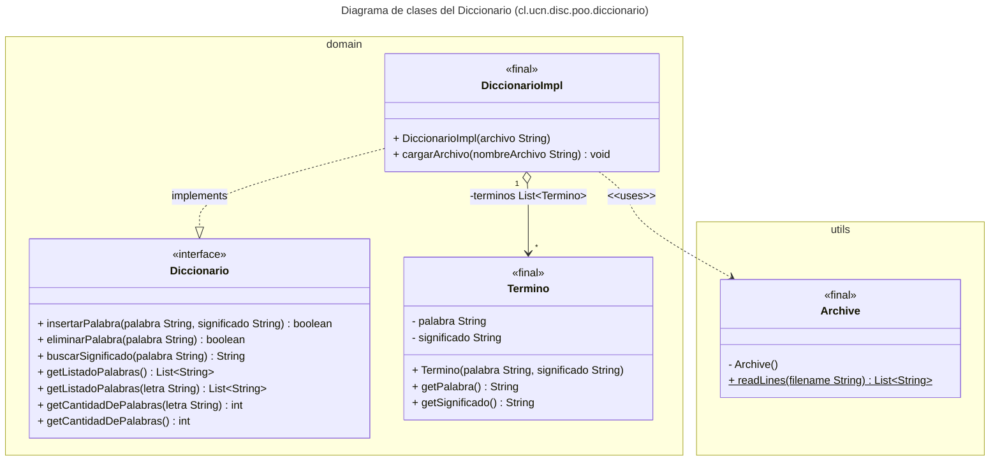

# El Diccionario

Gestión de un diccionario de palabras y significados en Java, cargado desde un archivo de texto y organizado alfabéticamente.

Proyecto de la asignatura **Programación Orientada al Objeto** (DISC, UCN).


---

## Problema que resuelve

Un conjunto de palabras con sus significados, guardado en un archivo de texto plano, es difícil de consultar y mantener: las palabras están desordenadas, buscar un significado exige recorrer el archivo a mano, y agregar o quitar entradas implica editarlo directamente.

Este proyecto resuelve ese problema cargando el archivo en memoria y ofreciendo una **API de diccionario** que permite:

- mantener las palabras **siempre ordenadas alfabéticamente**,
- **consultar** el significado de una palabra sin distinguir mayúsculas de minúsculas,
- **agregar y eliminar** palabras,
- **listar y contar** las palabras que comienzan con una letra determinada.

Además, es un ejemplo didáctico de programación orientada a objetos: separa el *contrato* (`Diccionario`) de su *implementación* (`DiccionarioImpl`), modela el dominio con una clase propia (`Termino`) y aísla el acceso a archivos en una clase utilitaria (`Archive`).

## Diseño



| Clase             | Responsabilidad                                                                          |
|-------------------|------------------------------------------------------------------------------------------|
| `Diccionario`     | Interface que define el contrato de operaciones.                                         |
| `DiccionarioImpl` | Implementación basada en una `List<Termino>` ordenada; carga el archivo al instanciarse. |
| `Termino`         | Par inmutable *(palabra, significado)*.                                                  |
| `Archive`         | Utilitaria para leer las líneas de un archivo.                                           |
| `TheMain`         | Programa principal que demuestra el uso del diccionario.                                 |

El diagrama está disponible en [`classes.puml`](classes.puml) (formato [PlantUML](https://plantuml.com/)).

## Estructura del proyecto

```
diccionario/
├── classes.puml                  # Diagrama de clases (PlantUML)
├── resources/
│   └── diccionario.txt           # Datos de entrada (palabra + significado)
└── src/cl/ucn/disc/poo/diccionario/
    ├── TheMain.java              # Punto de entrada
    ├── domain/
    │   ├── Diccionario.java      # Interface
    │   ├── DiccionarioImpl.java  # Implementación
    │   └── Termino.java          # Entidad de dominio
    └── utils/
        └── Archive.java          # Lectura de archivos
```

## Requisitos

- **JDK 11 o superior** (se utilizan `String.isBlank()` y `String.repeat()`).
- Opcional: IntelliJ IDEA, el proyecto incluye su configuración (`diccionario.iml`).

## Formato del archivo de datos

Una entrada por línea. La **primera palabra** de la línea es el término y **el resto** es su significado, separados por un espacio:

```
Paleografía Disciplina cuyo objeto es el estudio y la interpretación de las escrituras antiguas.
Efímero Que dura muy poco tiempo o es pasajero.
Nema Cierre o sello de una carta.
```

El archivo debe estar codificado en **UTF-8**. Las líneas vacías se ignoran, y las líneas sin significado o con palabras repetidas se informan por la salida de error y se omiten.

## Licencia

&copy; 2026 Programación Orientada al Objeto, DISC, UCN, Chile.
