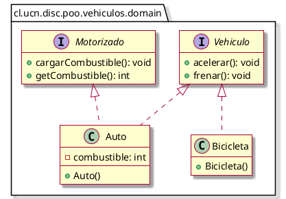

# Los Vehículos

Dado el siguiente diagrama de clases, se pide implementar las interfaces y clases correspondientes en Java.

Se pide:

1. Escriba las interfaces `Vehiculo` y `Motorizado`. (_8 puntos_)
2. Escriba la clase `Auto` que implementa ambas interfaces, con las siguientes reglas: (_15 puntos_)
    1. El combustible comienza en 10.
    2. `cargarCombustible()` incrementa el combustible en 5 e imprime `"Cargando combustible. Tanque: <combustible>"`.
    3. `getCombustible()` retorna el nivel actual.
    4. `acelerar()`: si `combustible > 0`, decrementa en 1 e imprime `"Auto acelerando"`. Si `combustible == 0`, imprime `"Auto sin combustible"`.
    5. `frenar()` imprime `"Auto frenando"`.
3. Escriba la clase `Bicicleta` que implementa solo `Vehiculo`. `acelerar()` imprime `"Bicicleta acelerando"`, `frenar()` imprime `"Bicicleta frenando"`. (_5 puntos_)
4. Escriba un método `void probarVehiculos(List<Vehiculo> vehiculos)` que itere la lista y, para cada Vehículo, invoque `acelerar()` y luego `frenar()`. (_5 puntos_)
5. Escriba un método `void revisarCombustible(List<Motorizado> vehiculos)` que itere la lista e imprima el combustible de cada Vehículo motorizado. (_4 puntos_)
6. Escriba un método `int contarConCombustible(List<Motorizado> vehiculos)` que recorra la lista y retorne cuántos Vehículos tienen combustible mayor que 0. (_5 puntos_)
7. Escriba un ejemplo de uso donde se creen dos listas: una `List<Vehiculo>` con un `Auto` y una `Bicicleta`; y una `List<Motorizado>` solo con el `Auto`. No utilice arreglos. (_3 puntos_)

---
&copy;2026 Programación Orientada al Objeto, DISC, UCN, Chile. Todos los derechos reservados.